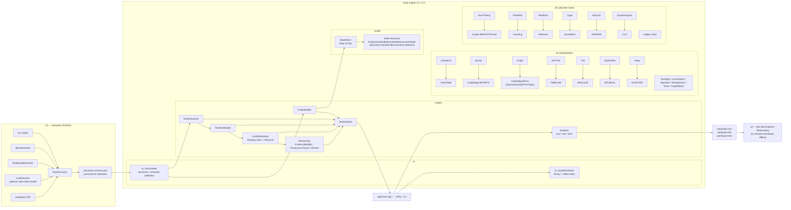

# ARCHITECTURE.md

## Data flow (one ingest cycle)

1. `ai/run_extract.py` reads `data/sample/*.txt` (or PDF/DOCX via readers),
   normalizes (CRLF→LF, NFC, single trailing newline), runs an extractor,
   validates against `ai/schema/extraction.schema.json` **and** semantic
   checks (code-point span exactness, reference integrity), writes
   `out/extraction.json`.
2. `verity ingest` re-validates EVERYTHING independently in C++
   (`io::JsonLoader` — schema-shaped structural checks + span slicing +
   reference integrity + confidence bounds), builds the typed evidence graph
   (`engine::GraphBuilder` over `ds::Graph<NodeId, EdgeAttr>` with a
   `model::NodeStore` owner), runs `EntityResolver` (Trie blocking →
   similarity policy → dm::Relation equivalence closure ↔ DisjointSet
   cross-check) and `TimelineBuilder` (strict-order check; cycle → finding
   with witness). Session path stored in `out/verity_session.json`.
3. Read commands re-load deterministically; `conflicts` grounds the
   rules.txt strategies through the HashTable claim index; `circular`,
   `keyentities`, `backbone`, `path`, `top-evidence`, `trace` run the
   reasoning engines; `export` writes the complete report payload the UI
   consumes; `save`/`load` persist binary records with an offset index;
   `verify-ledger` recomputes the teaching-grade chain.

## Ownership rules

* `model::NodeStore` owns all `Node` objects (raw `new`/`delete` inside the
  Rule-of-Five class; everything else passes `unique_ptr`).
* `ds`/`dm` are header-only and never own engine state.
* `ConflictListener`s are non-owning observers registered by callers.

## Wording contract

Findings carry the exact phrases "Potential contradiction" /
"Potential temporal contradiction". The UI, exporters and CLI never emit
truth verdicts, lie-detector claims or probabilities of truth. The noisy-OR
aggregate is labeled a confidence heuristic wherever it appears.
