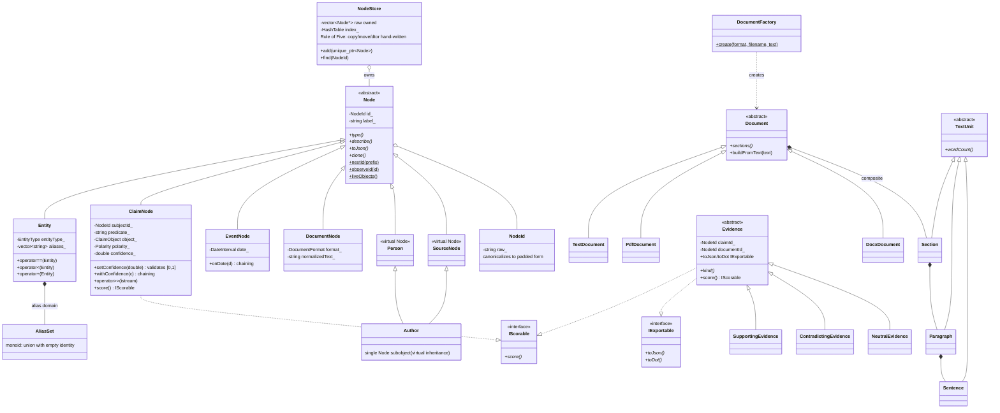

# CLASS_DIAGRAM.md — matches the real code

Key structural facts (each verified by a named test):

| Fact | Test |
|---|---|
| exactly one virtual Node base in the Author diamond | tests/oop/test_oop2.cpp "Author diamond" |
| NodeStore deep copy + self-assignment + move-from validity | tests/oop/test_nodestore.cpp |
| Evidence siblings (no chain) | tests/oop/test_oop2.cpp "Evidence siblings" |
| validated setter throws outside [0,1] | tests/oop/test_model.cpp "encapsulation" |
| AliasSet is a commutative monoid (empty identity) | tests/dm/test_algebra.cpp |
| Composite offsets slice exactly | tests/oop/test_oop2.cpp "Composite tree" |
